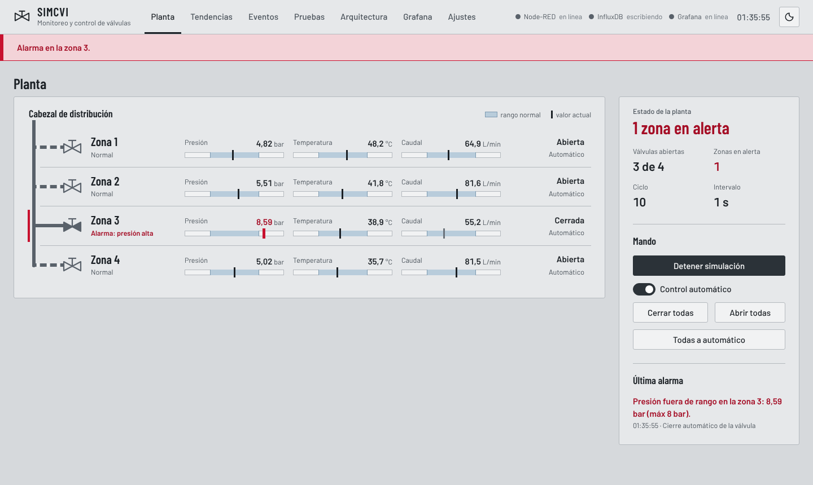

# SIMCVI · Sistema de Monitoreo y Control de Válvulas Industriales

Simulación de una red de distribución con válvulas por zona. Node-RED genera las lecturas de presión, temperatura y caudal, decide la apertura o el cierre de cada válvula, guarda todo en InfluxDB 2 y lo muestra en una interfaz de operación propia y en un tablero de Grafana con consultas Flux.

Proyecto académico · Universidad Cooperativa de Colombia, sede Villavicencio · Electiva 3
Autores: Andrés Felipe Cohecha Mosquera (816967) y Santiago Veloza Quintero (813137)



---

## Contenido

1. [Arquitectura](#1-arquitectura)
2. [Requisitos](#2-requisitos)
3. [Puesta en marcha paso a paso](#3-puesta-en-marcha-paso-a-paso)
4. [Dónde va cada archivo](#4-dónde-va-cada-archivo)
5. [Recorrido de demostración (10 minutos)](#5-recorrido-de-demostración-10-minutos)
6. [Vistas de la interfaz](#6-vistas-de-la-interfaz)
7. [Lógica de control](#7-lógica-de-control)
8. [Datos en InfluxDB y consultas Flux](#8-datos-en-influxdb-y-consultas-flux)
9. [Grafana](#9-grafana)
10. [API HTTP y WebSocket](#10-api-http-y-websocket)
11. [Pruebas](#11-pruebas)
12. [Seguridad](#12-seguridad)
13. [Operación diaria](#13-operación-diaria)
14. [Solución de problemas](#14-solución-de-problemas)
15. [Qué se verificó y qué no](#15-qué-se-verificó-y-qué-no)
16. [Licencias de terceros](#16-licencias-de-terceros)

---

## 1. Arquitectura

```
                         navegador (http://localhost:1880)
          ┌───────────────────────────────────────────────────────────┐
          │  Interfaz SIMCVI: Planta · Tendencias · Eventos · Pruebas │
          │  Arquitectura · Grafana (iframe) · Ajustes                │
          └──────────────▲───────────────┬───────────────▲────────────┘
            WebSocket    │               │ REST /api     │ tablero embebido
            /ws/simcvi   │               ▼               │
          ┌──────────────┴───────────────────────┐   ┌───┴──────────────┐
          │ Node-RED 5.0.7                        │   │ Grafana 13.2.3   │
          │  · ciclo de simulación y control      │   │  tablero         │
          │  · núcleo de dominio (core/)          │   │  simcvi-planta   │
          │  · API, WebSocket y archivos de ui/   │   └───▲──────────────┘
          └──────────────┬───────────────────────┘       │ consultas Flux
                         │ HTTP /api/v2/write             │
                         ▼ (protocolo de línea)           │
                ┌─────────────────────────────────────────┴──┐
                │ InfluxDB 2.9.1 · organización y bucket simcvi │
                └────────────────────────────────────────────┘
```

| Servicio | Imagen | Dirección | Función |
|---|---|---|---|
| Node-RED | `nodered/node-red:5.0.7` | http://localhost:1880 (interfaz) · http://localhost:1880/admin (editor) | Simulación, control, API, WebSocket e interfaz web |
| InfluxDB | `influxdb:2.9.1` | http://localhost:8086 | Base de datos de series de tiempo; lenguaje Flux |
| Grafana | `grafana/grafana:13.2.3` | http://localhost:3000 | Tablero histórico con consultas Flux |

No hay broker MQTT: los sensores son simulados dentro de Node-RED. Las decisiones de diseño están en [docs/adr](docs/adr/README.md).

> **Cambio respecto al documento de avance (v3):** se usa **InfluxDB 2.9 con Flux** y no InfluxDB 3 Core, porque InfluxDB 3 no soporta Flux. Ver [ADR-0002](docs/adr/0002-influxdb-2-flux.md) y la lista de secciones del documento por ajustar al final de la entrega.

---

## 2. Requisitos

| Requisito | Detalle |
|---|---|
| Docker | Windows y macOS: **Docker Desktop** actualizado. Linux: Docker Engine con el complemento **Compose v2** (`docker compose version`). |
| Memoria | 4 GB libres para los tres contenedores. |
| Puertos libres | 1880, 3000 y 8086. |
| Navegador | Chrome, Edge o Firefox recientes. |
| Internet | Solo la primera vez, para descargar las imágenes de Docker (varios cientos de MB). La interfaz funciona sin internet. |
| Node.js (opcional) | Versión 22 o superior, solo para ejecutar las pruebas unitarias fuera de Docker. |

---

## 3. Puesta en marcha paso a paso

### Paso 1 · Ubicar la carpeta del proyecto

Descomprima `simcvi.zip` en una carpeta de trabajo sin espacios ni sincronización en la nube, por ejemplo:

- Windows: `C:\proyectos\simcvi` (evite OneDrive, Escritorio o Documentos sincronizados: Docker Desktop puede fallar al montar carpetas sincronizadas).
- Linux o macOS: `~/proyectos/simcvi`

Abra una terminal **dentro de esa carpeta** (PowerShell en Windows, Terminal en macOS o Linux). Todos los comandos siguientes se ejecutan desde ahí.

Si van a usar Git, este es el momento de crear el repositorio: `git init`, primer commit y luego `git push`. El archivo `.gitignore` ya excluye `.env` y los archivos que genera Node-RED.

### Paso 2 · Crear el archivo de secretos `.env`

Windows (PowerShell):

```powershell
.\scripts\init-env.ps1
```

Si PowerShell bloquea el script por la política de ejecución:

```powershell
powershell -ExecutionPolicy Bypass -File .\scripts\init-env.ps1
```

Linux, macOS o Git Bash:

```bash
bash scripts/init-env.sh
```

El script copia `.env.example` en `.env` y genera contraseñas y tokens aleatorios. No sobrescribe un `.env` existente. **Nunca suba `.env` al repositorio.**

Para ver las contraseñas de los editores:

```powershell
Select-String -Path .env -Pattern 'NR_ADMIN_PASSWORD|GRAFANA_ADMIN_PASSWORD'   # PowerShell
```
```bash
grep -E 'NR_ADMIN_PASSWORD|GRAFANA_ADMIN_PASSWORD' .env                      # bash
```

### Paso 3 · Levantar los servicios

```bash
docker compose up -d
```

La primera vez descarga las imágenes. InfluxDB se configura solo (usuario, organización `simcvi`, bucket `simcvi` con retención de 30 días y token). Node-RED y Grafana esperan a que InfluxDB esté sano.

### Paso 4 · Verificar

```bash
docker compose ps
```

Los tres servicios deben aparecer como `running`; InfluxDB y Node-RED, además, como `healthy` (tarda unos 30 segundos).

Abra **http://localhost:1880**. En la cabecera deben verse los tres indicadores en línea: Node-RED, InfluxDB «escribiendo» y Grafana. La planta muestra cuatro zonas y la simulación arranca sola.

| Qué abrir | Dirección | Usuario |
|---|---|---|
| Interfaz de operación | http://localhost:1880 | no requiere |
| Editor de Node-RED | http://localhost:1880/admin | `admin` y `NR_ADMIN_PASSWORD` de `.env` |
| Grafana | http://localhost:3000 | lectura anónima; para editar, `admin` y `GRAFANA_ADMIN_PASSWORD` |
| InfluxDB (Data Explorer) | http://localhost:8086 | `admin` e `INFLUX_ADMIN_PASSWORD` |

### Paso 5 · Aplicar mínimo privilegio (recomendado antes de sustentar)

El arranque rápido usa el token de administración de InfluxDB en Node-RED y Grafana. Para que Node-RED solo pueda **escribir** y Grafana solo pueda **leer** el bucket:

1. Cree los dos tokens (el script corre dentro del contenedor de InfluxDB y toma el token de administración de su entorno, así no queda en el historial de su terminal):

   ```bash
   docker compose exec influxdb sh /opt/simcvi/crear-tokens.sh
   ```

2. El script imprime dos líneas, `NODERED_INFLUX_TOKEN=...` y `GRAFANA_INFLUX_TOKEN=...`. Reemplace con ellas las líneas del mismo nombre en `.env`. InfluxDB 2.9 guarda los tokens con hash: esta es la única vez que se muestran.
3. Aplique los cambios: `docker compose up -d` (Compose recrea Node-RED y Grafana con los tokens nuevos).
4. Compruebe que la cabecera de la interfaz sigue mostrando InfluxDB «escribiendo» y que Grafana muestra datos.

Si ejecuta el script más de una vez, se crean tokens nuevos; los anteriores se pueden borrar en http://localhost:8086 → Load Data → API Tokens.

---

## 4. Dónde va cada archivo

```
simcvi/
├── docker-compose.yml          Servicios, puertos (solo 127.0.0.1), volúmenes y variables
├── .env.example                Plantilla de variables; los secretos se generan en .env
├── .gitignore / .gitattributes
├── package.json                npm test → pruebas unitarias del núcleo
├── scripts/
│   ├── init-env.sh             Genera .env (Linux, macOS, Git Bash)
│   ├── init-env.ps1            Genera .env (Windows PowerShell)
│   └── influxdb/               Se montan en el contenedor de InfluxDB (/opt/simcvi)
│       ├── crear-tokens.sh     Tokens de mínimo privilegio para Node-RED y Grafana
│       └── respaldo.sh         Respaldo con influx backup
├── core/                       Núcleo de dominio en JavaScript (sin dependencias)
│   ├── index.js                Fachada que usan los nodos de Node-RED
│   ├── config.js               Parámetros, límites y validación atómica
│   ├── simulacion.js           Proceso con reversión a la media, anomalías e incendios
│   ├── control.js              Reglas de control y emergencia
│   ├── eventos.js · metricas.js
│   ├── line-protocol.js        Serialización al protocolo de línea de InfluxDB
│   ├── api.js                  Enrutador de la API con listas blancas
│   └── test/                   Pruebas unitarias (node --test)
├── node-red/                   Directorio de usuario de Node-RED (montado en /data)
│   ├── settings.js             Rutas, autenticación del editor y carga del núcleo
│   └── flows.json              Flujos: 1 · Simulación y control, 2 · API y tiempo real, 3 · Persistencia y salud
├── ui/                         Interfaz web que sirve Node-RED en /
│   ├── index.html
│   ├── css/tokens.css · app.css
│   ├── js/main.js · api.js · store.js · util.js
│   ├── js/vistas/              planta, zona, tendencias, eventos, pruebas, arquitectura, grafana, ajustes
│   ├── img/icono.svg
│   └── vendor/                 Chart.js 4.5.1 y fuentes Barlow (funciona sin internet)
├── grafana/
│   ├── provisioning/datasources/influxdb.yaml   Fuente de datos Flux (uid simcvi-influx)
│   ├── provisioning/dashboards/simcvi.yaml      Proveedor de tableros
│   └── dashboards/simcvi-planta.json            Tablero con 13 paneles
├── docs/
│   ├── adr/                    Registro de decisiones de arquitectura
│   └── img/                    Capturas de la interfaz
└── .github/                    CI (pruebas y validación de Compose) y Dependabot
```

El prototipo anterior (`index.html`, `styles.css`, `app.js`) queda reemplazado por la carpeta `ui/`. Si quieren conservarlo como evidencia del proceso, guárdenlo en `docs/prototipo/`.

---

## 5. Recorrido de demostración (10 minutos)

Un guion para la sustentación que recorre los seis escenarios del informe:

1. **Planta.** Explique el sinóptico: cabezal, ramales, válvulas ISA y barras analógicas. La banda azul grisácea es el rango normal; el color rojo solo aparece en condiciones anormales.
2. **Pruebas → EP-01.** «Iniciar observación»: diez ciclos consecutivos sin alarmas, válvulas abiertas e InfluxDB escribiendo.
3. **Pruebas → EP-02.** Zona 2, temperatura, por encima del máximo. Se registra la alarma, la válvula se cierra y aparece el tiempo de decisión.
4. **Pruebas → EP-03.** Sin hacer nada: la válvula se reabre tras dos ciclos normales (histéresis) y se mide el tiempo de recuperación.
5. **Pruebas → EP-04.** Cierre manual de la zona 3: la orden prevalece sobre el control automático y queda en el registro. Devuelva la zona a automático.
6. **Pruebas → EP-05.** Incendio en la zona 4: todas las válvulas se cierran y la franja roja permite restablecer en dos pasos (pulsar y confirmar).
7. **Pruebas → EP-06.** «Iniciar observación», luego `docker compose stop influxdb`: la planta sigue operando y la cabecera marca InfluxDB sin conexión. Después `docker compose start influxdb`.
8. **Arquitectura.** Los pulsos muestran cada instantánea por WebSocket y cada escritura en InfluxDB; abajo, la última escritura en protocolo de línea y la consulta Flux que usa Grafana.
9. **Grafana.** El histórico de los mismos eventos, consultado con Flux.
10. **Descargar resultados (JSON)** en Pruebas y **Descargar CSV** en Eventos: son las evidencias para la sección de resultados del informe.

---

## 6. Vistas de la interfaz

| Vista | Para qué sirve |
|---|---|
| Planta | Sinóptico en vivo, estado de la planta, mando global (simulación, control automático, todas las válvulas). Clic en una zona abre su detalle: lecturas, tendencia de los últimos ciclos, mando manual y pruebas. |
| Tendencias | Gráfica en vivo de la variable elegida por zona, con la banda del rango normal y los puntos fuera de rango marcados. |
| Eventos | Registro filtrable por severidad, zona y texto; descarga en CSV. |
| Pruebas | Escenarios EP-01 a EP-06 con evaluación automática (Cumple / No cumple) e indicadores: tasa de detección, falsas alarmas, tiempo de respuesta, cierre total ante incendio e integridad del almacenamiento. Descarga en JSON. |
| Arquitectura | Diagrama vivo del recorrido de los datos, estado de cada servicio, última escritura en protocolo de línea y consulta Flux de ejemplo. |
| Grafana | Tablero histórico embebido (solo lectura). |
| Ajustes | Número de zonas, intervalo, probabilidades, control automático, ciclos de reapertura y rangos. Node-RED valida todo de forma atómica: si un valor es inválido no se aplica ninguno. |

Accesibilidad: navegación completa con teclado, foco visible, panel de zona modal (Esc lo cierra), textos que no dependen del color, temas claro y oscuro, y respeto de «reducir movimiento» del sistema operativo.

---

## 7. Lógica de control

Prioridades, de mayor a menor, en cada ciclo y para cada zona:

1. **Emergencia por incendio.** Cierra todas las válvulas y bloquea la apertura (la API responde 409) hasta que el operador la restablece.
2. **Mando manual.** La orden del operador prevalece sobre el control automático hasta devolver la zona a «Automático».
3. **Control automático apagado.** Se registran las alarmas, pero no se mueve ninguna válvula.
4. **Control automático.** Cierra la válvula ante cualquier variable fuera de rango y la reabre tras `ticksReapertura` ciclos normales consecutivos (histéresis, evita aperturas y cierres repetidos).

La alarma de caudal mínimo se suprime cuando la válvula está cerrada (supresión por estado, buena práctica de gestión de alarmas según ISA-18.2 / IEC 62682): sin esa regla, cerrar una válvula generaría una falsa alarma.

Las métricas de evaluación usan la «verdad de campo» de la simulación: cada anomalía inyectada se marca y se compara con lo que detectó el control, por eso es posible calcular la tasa de detección y la de falsas alarmas.

---

## 8. Datos en InfluxDB y consultas Flux

Bucket `simcvi`, organización `simcvi`, precisión de nanosegundos.

| Medición | Etiquetas | Campos |
|---|---|---|
| `telemetria` | `zona` | `presion`, `temperatura`, `caudal` (float); `valvula_abierta`, `en_alerta`, `incendio`, `anomalia_inyectada`, `mando_manual` (bool) |
| `eventos` | `tipo`, `severidad`, `origen`, `zona`, `variable` | `id` (int), `mensaje`, `limite`, `accion` (texto), `valor`, `tiempo_respuesta_ms` (float) |
| `planta` | — | `zonas`, `zonas_alerta`, `valvulas_abiertas` (int); `emergencia`, `modo_auto`, `simulacion_activa` (bool) |
| `limites` | `variable` | `min`, `max` (float) |

Ejemplo de línea escrita por Node-RED:

```
telemetria,zona=1 presion=5.2641,temperatura=40.6539,caudal=73.6726,valvula_abierta=true,en_alerta=false,incendio=false,anomalia_inyectada=false,mando_manual=false 1791422364970000000
```

Consultas para practicar en el Data Explorer de InfluxDB (http://localhost:8086 → Data Explorer → Script Editor):

```flux
// Presión media por zona en ventanas de 30 s
from(bucket: "simcvi")
  |> range(start: -15m)
  |> filter(fn: (r) => r._measurement == "telemetria" and r._field == "presion")
  |> aggregateWindow(every: 30s, fn: mean, createEmpty: false)
```

```flux
// Alarmas por variable en la última hora
from(bucket: "simcvi")
  |> range(start: -1h)
  |> filter(fn: (r) => r._measurement == "eventos" and r._field == "id" and r.tipo == "alarma")
  |> group(columns: ["variable"])
  |> count()
```

```flux
// Tiempo de respuesta del control: media, máximo y percentil 95
datos = from(bucket: "simcvi")
  |> range(start: -1h)
  |> filter(fn: (r) => r._measurement == "eventos" and r._field == "tiempo_respuesta_ms" and r.tipo == "cierre_auto")
  |> group()

datos |> mean() |> yield(name: "media")
datos |> max() |> yield(name: "maximo")
datos |> quantile(q: 0.95) |> yield(name: "p95")
```

---

## 9. Grafana

Grafana carga automáticamente la fuente de datos **InfluxDB SIMCVI** (Flux) y el tablero **SIMCVI · Planta** (carpeta SIMCVI), que además es la página de inicio:

- Indicadores: válvulas abiertas, zonas en alarma, parada de emergencia, alarmas en el periodo, respuesta media del control y lecturas almacenadas.
- Presión, temperatura y caudal por zona con los límites configurados como líneas discontinuas.
- Líneas de tiempo del estado de las válvulas y de las alarmas por zona.
- Tiempo de respuesta de cada cierre y registro de eventos.
- Variable `zona` para filtrar zonas.

Para modificar el tablero: entre como `admin`, edite, use **Export → Export as JSON** y reemplace `grafana/dashboards/simcvi-planta.json`. Grafana lo recarga en 30 segundos. Los cambios guardados solo en la interfaz de Grafana no persisten, porque el repositorio es la fuente de verdad.

---

## 10. API HTTP y WebSocket

Todas las respuestas son JSON: `{ "ok": true, ... }` o `{ "ok": false, "error": { "codigo", "mensaje", "detalles"? } }`.

| Método y ruta | Cuerpo | Respuesta |
|---|---|---|
| `GET /api/estado` | — | 200 `{ instantanea }` |
| `GET /api/historial` | — | 200 `{ historial }` (últimos 300 ciclos) |
| `POST /api/simulacion/{iniciar\|detener}` | — | 200 |
| `PUT /api/config` | Cambios parciales: `zonas`, `intervaloSeg`, `probAnomaliaPct`, `probIncendioPct`, `modoAuto`, `ticksReapertura`, `rangos.{variable}.{min,max}` | 200, 400 o 422 con `detalles` |
| `POST /api/valvulas/{zona\|todas}/{abrir\|cerrar\|auto}` | — | 200, 404 o 409 (emergencia activa) |
| `POST /api/emergencia/restablecer` | — | 200 o 409 |
| `POST /api/pruebas/anomalia/{zona}` | `{ "variable"?: "presion\|temperatura\|caudal", "direccion"?: "alta\|baja" }` | 202, 404 o 409 |
| `POST /api/pruebas/incendio/{zona}` | — | 202, 404 o 409 |
| `POST /api/metricas/reiniciar` | — | 200 |

WebSocket `ws://localhost:1880/ws/simcvi`: al conectarse, el cliente envía `{"tipo":"hola"}` y recibe la instantánea actual; después recibe una instantánea en cada ciclo y tras cada orden.

Ejemplo: inyectar una anomalía de presión alta en la zona 2.

```bash
# bash
curl -s -X POST http://localhost:1880/api/pruebas/anomalia/2 -H "Content-Type: application/json" -d '{"variable":"presion","direccion":"alta"}'
```

```powershell
# PowerShell (en Windows PowerShell 5.1, «curl» es un alias de otro comando)
Invoke-RestMethod -Method Post -Uri http://localhost:1880/api/pruebas/anomalia/2 -ContentType 'application/json' -Body '{"variable":"presion","direccion":"alta"}'
```

---

## 11. Pruebas

| Nivel | Qué cubre | Cómo ejecutarlo |
|---|---|---|
| Unitarias (14) | Validación de configuración, simulación reproducible con semilla, prioridades de control, histéresis, supresión de caudal, emergencia, métricas, protocolo de línea, enrutador de la API | `npm test` (Node.js 22 o superior) |
| Escenarios EP-01 a EP-06 | Comportamiento extremo a extremo con evaluación automática | Vista **Pruebas** de la interfaz |
| Integración continua | Pruebas unitarias y validación de `docker-compose.yml` en cada *push* | `.github/workflows/ci.yml` |

Los indicadores de la vista Pruebas se reinician con «Reiniciar métricas». Para el informe, ejecute los escenarios, descargue el JSON y reporte media, desviación y p95 del tiempo de respuesta junto con la tasa de detección y la integridad del almacenamiento.

---

## 12. Seguridad

Resumen de controles (detalle y riesgos aceptados en [ADR-0005](docs/adr/0005-seguridad-entorno-local.md)):

- Puertos publicados solo en `127.0.0.1`: nada queda expuesto en la red local.
- Secretos aleatorios en `.env`, fuera de Git; Compose no arranca si faltan.
- Editor de Node-RED con usuario y contraseña (mínimo 12 caracteres, comparación en tiempo constante).
- Tokens de InfluxDB de mínimo privilegio (paso 5).
- API con listas blancas y validación atómica; la interfaz inserta texto con `textContent` y aplica una CSP estricta.
- Contenedores de Node-RED y Grafana sin privilegios adicionales (`no-new-privileges`, `cap_drop: ALL`).

**Antes de exponer SIMCVI en una red**, agregue autenticación a la API y al WebSocket y sirva todo por HTTPS detrás de un proxy inverso. La API actual no tiene autenticación propia.

---

## 13. Operación diaria

| Tarea | Comando |
|---|---|
| Ver estado | `docker compose ps` |
| Ver registros | `docker compose logs -f node-red` (o `influxdb`, `grafana`) |
| Detener sin borrar datos | `docker compose stop` |
| Volver a iniciar | `docker compose start` |
| Aplicar cambios de `core/` o `ui/` | `ui/`: recargar el navegador. `core/`: `docker compose restart node-red` |
| Apagar y quitar contenedores | `docker compose down` (los datos permanecen en los volúmenes) |
| Borrar todo y empezar de cero | `docker compose down -v` (borra InfluxDB y Grafana) |
| Respaldo de InfluxDB | `docker compose exec influxdb sh /opt/simcvi/respaldo.sh` y luego `docker compose cp influxdb:/var/lib/influxdb2/respaldos ./respaldos` |

Los flujos se pueden editar en http://localhost:1880/admin; al pulsar **Deploy**, Node-RED guarda los cambios en `node-red/flows.json`, que queda listo para *commit*.

---

## 14. Solución de problemas

| Síntoma | Causa probable | Solución |
|---|---|---|
| `required variable ... is missing a value: falta el archivo .env` | No se creó `.env` | Paso 2 |
| `Bind for 127.0.0.1:1880 failed: port is already allocated` | Otro programa usa el puerto (otra instancia de Node-RED, por ejemplo) | Ciérrelo o cambie el puerto izquierdo en `docker-compose.yml` (`"127.0.0.1:1881:1880"`) |
| Node-RED se reinicia y el registro dice `NR_ADMIN_PASSWORD debe tener al menos 12 caracteres` | `.env` incompleto | Regenere `.env` (paso 2) |
| Linux: `EACCES: permission denied` en `/data` | La carpeta `node-red/` no pertenece al usuario 1000 del contenedor | `sudo chown -R 1000:1000 node-red` |
| La cabecera muestra InfluxDB «sin conexión» | InfluxDB detenido o token inválido | `docker compose ps`; `docker compose logs node-red`; si cambió tokens, revise `.env` y ejecute `docker compose up -d` |
| InfluxDB rechaza las credenciales tras regenerar `.env` | InfluxDB conserva las credenciales de la primera ejecución | `docker compose down -v` y `docker compose up -d` (borra los datos) |
| La vista Grafana dice «Grafana no responde» | El contenedor no arrancó | `docker compose logs --tail 50 grafana` |
| El tablero de Grafana aparece en blanco dentro de la interfaz | Se cambió `GRAFANA_PUBLIC_URL` y la CSP bloquea el iframe | Agregue la nueva dirección a `frame-src` en `ui/index.html` |
| Los paneles de Grafana muestran error justo al primer arranque | Aún no hay datos para la variable `zona` | Espere unos segundos y recargue el tablero |
| Windows: `docker` no se reconoce | Docker Desktop no está instalado o no está en ejecución | Inicie Docker Desktop y espere a que diga «Engine running» |

---

## 15. Qué se verificó y qué no

Verificado en el entorno de desarrollo:

- 14 pruebas unitarias del núcleo (`npm test`).
- Node-RED 5.0.7 con `settings.js` y `flows.json` del proyecto, contra un simulador estricto de las API de InfluxDB 2 (`/api/v2/write`, `/health`) y de Grafana (`/api/health`): API, WebSocket, escritura en las cuatro mediciones, autenticación del editor (401 sin credenciales) y caída de InfluxDB (EP-06).
- Interfaz completa en Chromium (Playwright): seis escenarios EP-01 a EP-06 con resultado «Cumple», panel de zona, emergencia con restablecimiento en dos pasos, filtros y descargas, validación de ajustes, tema oscuro, vista móvil sin desplazamiento horizontal y cero errores en la consola.
- `docker-compose.yml` validado con `docker compose config`.
- Las 17 consultas Flux del tablero, validadas sintáctica y semánticamente con el analizador oficial de Flux (`@influxdata/flux-lsp-browser`), y el modelo del tablero, verificado contra los tipos de `@grafana/schema` 13.2.3.

No verificado (el entorno de desarrollo no podía descargar imágenes de Docker):

- Ejecución real de los contenedores de InfluxDB 2.9.1 y Grafana 13.2.3, de las consultas Flux sobre datos reales y del renderizado del tablero. Es lo primero que hay que comprobar en el paso 4.
- `scripts/init-env.ps1` (no había PowerShell disponible); `init-env.sh` sí se probó.
- `scripts/influxdb/crear-tokens.sh` y `respaldo.sh` contra el `influx` real: se probó la lógica del script con un `influx` simulado.

---

## 16. Licencias de terceros

- Chart.js 4.5.1 — licencia MIT (`ui/vendor/LICENSE-chartjs.md`).
- Barlow y Barlow Condensed — SIL Open Font License 1.1 (`ui/vendor/fonts/LICENSE-OFL.txt`).
- Node-RED (Apache 2.0), InfluxDB OSS 2 (MIT) y Grafana OSS (AGPL-3.0) se usan como imágenes oficiales sin modificar.
